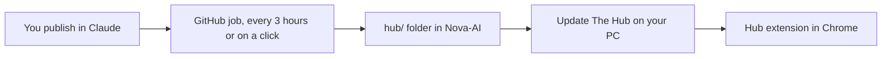

# Make My Hub

**Link:** https://claude.ai/artifact/9aQgcMWmM7zPBkhuhRKbWu

## Boiled down

You already built the home. It is **My Hub**, the Claude page above.

A copy of it now lives in this repo in [`hub/`](../hub). It stays in sync with Claude on its own, so ChatGPT Codex and Claude can both read and work on the same hub. There is no switch that connects the two accounts, and you never hand over a password.

## How updates work

- **The Hub page** updates itself. Claude serves the newest version every time you open the link.
- **The copy in this repo** updates itself. A GitHub job checks Claude every 3 hours and saves anything new.
- **The Chrome extension** updates with one double-click on **Update The Hub**, or every day by itself if you turn that on.

## Set it up (one time)

1. Make sure this setup is on the `main` branch (merge the pull request that added it). The GitHub job only runs from `main`.
2. On your Windows PC, open https://github.com/Daleah666/Nova-AI/blob/main/updater/Update-The-Hub.bat and click the download button (the arrow, top right of the file).
3. Double-click the downloaded file. If Windows says "Windows protected your PC", click **More info**, then **Run anyway**.
4. It asks two questions. Type **Y** and press Enter for each:
   - Put an **Update The Hub** shortcut on your desktop
   - Check for updates by itself every day
5. Done. You can delete the downloaded file. The updater keeps its own copy and updates itself too.

## Buttons

| What | Where | What it does |
| --- | --- | --- |
| **Update The Hub** | Your desktop | Downloads the newest extension and installs it. One double-click, no questions. |
| **Run workflow** | GitHub, **Actions** tab, **Sync My Hub from Claude** | Pulls your newest Claude version into this repo right now instead of waiting up to 3 hours. |
| **Update** bubble | Inside the Hub | Shows when the extension is behind. Then double-click **Update The Hub** on your desktop. |

## Pieces already on the page

- Calendar and to-dos
- Daily focus and quote
- Character picture
- App groups: Companions, Studio, Avatar lab, AI, Everyday, Mini windows
- Hub bar: Apps, Library, AI & keys, Agents board, What's running, Settings
- Side panel: Chat, To-do, Today, Activity, Pulse, Me, Pictures, Files, AI & keys, Agents, Add-ons, Settings

## What is in the repo

- [`hub/index.html`](../hub/index.html): the Hub page
- [`hub/apps/familiar.html`](../hub/apps/familiar.html): Familiar, the companion app
- [`hub/ext/hub-extension.json`](../hub/ext/hub-extension.json): the Chrome extension, packed the way Claude stores it
- [`hub/extension/`](../hub/extension): the same extension unpacked, so agents can read it. This includes `relay/`, which connects Claude Code and Codex.
- [`hub/version.json`](../hub/version.json): which Claude version this copy is
- [`scripts/sync-hub.mjs`](../scripts/sync-hub.mjs): pulls the newest version from Claude
- [`updater/Update-The-Hub.bat`](../updater/Update-The-Hub.bat): the Windows updater

Everything in `hub/` is overwritten by each sync. Change the hub in Claude, not here.

## Rule

Do not paste API keys, passwords, or signed-in chats into this repo. Those stay locked on Claude and only show when you are signed in.
