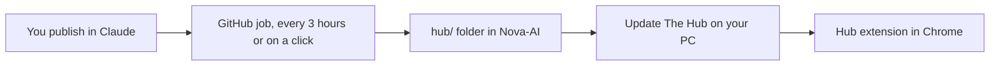

# Make My Hub

**Link:** https://claude.ai/artifact/9aQgcMWmM7zPBkhuhRKbWu

## Boiled down

You already built the home. It is **My Hub**, the Claude page above.

A copy of it now lives in this repo in [`hub/`](../hub). It stays in sync with Claude on its own, so ChatGPT Codex and Claude can both read and work on the same hub. There is no switch that connects the two accounts, and you never hand over a password.

## How updates work



- **The Hub page** updates itself. Claude serves the newest version every time you open the link.
- **The copy in this repo** updates itself. A GitHub job checks Claude every 3 hours and saves anything new.
- **The Chrome extension** updates with one double-click on **Update The Hub**, or every day by itself if you turn that on.

## Set it up (one time)

1. Make sure this setup is on the `main` branch (merge the pull request that added it). The GitHub job only runs from `main`.
2. On your Windows PC, open https://github.com/Daleah666/Nova-AI/blob/main/updater/Update-The-Hub.bat and click the download button (the arrow, top right of the file).
3. Double-click the downloaded file. If Windows says "Windows protected your PC", click **More info**, then **Run anyway**.
4. It asks two questions. Type **Y** and press Enter for each:
   - Put an **Update The Hub** shortcut on your desktop
   - Check for updates by itself every day
5. Done. You can delete the downloaded file. The updater keeps its own copy and updates itself too.

## Buttons

| What | Where | What it does |
| --- | --- | --- |
| **Update The Hub** | Your desktop | Downloads the newest extension and installs it. One double-click, no questions. |
| **Run workflow** | GitHub, **Actions** tab, **Sync My Hub from Claude** | Pulls your newest Claude version into this repo right now instead of waiting up to 3 hours. |
| **Update** bubble | Inside the Hub | Shows when the extension is behind. Then double-click **Update The Hub** on your desktop. |

## Run it on your computer

The files in [`hub/`](../hub) are the page. A sync replaces that whole folder, so the start script lives next to it and does not get wiped.

1. Install Node.js if you do not have it (the LTS version from [nodejs.org](https://nodejs.org)).
2. In this folder, run `npm install` once. If `package-lock.json` is there, `npm ci` works too.
3. Run `npm run dev`.
4. Open http://127.0.0.1:8080/

Leave that terminal open. It serves My Hub and starts the relay on this computer (`127.0.0.1` port `47800`). Run the command again and it notices they are already up.

You do not need the Chrome extension for the page to load. The extension is still what new tabs, the mic, and tidy tabs use. On Windows, **Update The Hub** still updates that extension.

### Keys (optional)

Copy [`.env.example`](../.env.example) to a file named `.env` in this same folder. Fill in only the keys you have. `.env` stays on your computer. Do not commit it, and do not paste keys into the repo.

- **ANTHROPIC_API_KEY** — Claude, for chatting with Nyx and for Familiar's brain. If this is empty, chat tells you the key is missing. The clock, to-dos, and apps still work.
- **XAI_API_KEY** — Grok pictures. You can leave this empty and paste the key in the Hub instead (robot icon, **AI & keys**). A pasted key is saved in `~/.the-hub/xai-key` on your computer, not in this repo. If both are set, the pasted key is the one that is used. **Remove key** in the Hub deletes the pasted one. To drop the `.env` key, delete that line and start `npm run dev` again.

Google Calendar, Drive, and Gmail do not use a key in this repo. The page reaches them through Claude's connectors, which only exist when you open the Hub on claude.ai while you are signed in. Locally, the page says that.

ActivityWatch is optional. If that app is running on your computer (port `5600`), the Activity tab shows your apps. If it is not installed, the page tells you where to get it. Nothing is filled in for it.

### Pull an update

```
npm run sync-hub
```

That is the update. It downloads the newest Hub from Claude into `hub/` and checks each file's checksum. Your `.env`, the scripts, and these notes stay put. The same command runs on GitHub every few hours once this is on `main`.

### See what is connected

While `npm run dev` is running, open http://127.0.0.1:8080/__dev/status

It says whether Claude, Grok, the relay, and ActivityWatch are connected. It does not show your keys.

Relay health check (no key): http://127.0.0.1:47800/health

To start only the relay: `npm run relay`

## Pieces already on the page

- Calendar and to-dos
- Daily focus and quote
- Character picture
- App groups: Companions, Studio, Avatar lab, AI, Everyday, Mini windows
- Hub bar: Apps, Library, AI & keys, Agents board, What's running, Settings
- Side panel: Chat, To-do, Today, Activity, Pulse, Me, Pictures, Files, AI & keys, Agents, Add-ons, Settings

## What is in the repo

- [`hub/index.html`](../hub/index.html): the Hub page
- [`hub/apps/familiar.html`](../hub/apps/familiar.html): Familiar, the companion app
- [`hub/ext/hub-extension.json`](../hub/ext/hub-extension.json): the Chrome extension, packed the way Claude stores it
- [`hub/extension/`](../hub/extension): the same extension unpacked, so agents can read it. This includes `relay/`, which connects Claude Code and Codex.
- [`hub/version.json`](../hub/version.json): which Claude version this copy is
- [`scripts/sync-hub.mjs`](../scripts/sync-hub.mjs): pulls the newest version from Claude
- [`scripts/dev-hub.mjs`](../scripts/dev-hub.mjs): serves the Hub on your computer and starts the relay
- [`scripts/hub-bridge.js`](../scripts/hub-bridge.js): talks to that local server for Claude, Grok, and the relay
- [`.env.example`](../.env.example): the list of optional keys, with no real secrets
- [`updater/Update-The-Hub.bat`](../updater/Update-The-Hub.bat): the Windows updater

Everything in `hub/` is overwritten by each sync. Change the hub in Claude, not here. The scripts and `.env` are outside `hub/`, so a sync leaves them alone.

## Rule

Do not paste API keys, passwords, or signed-in chats into this repo. Those stay locked on Claude and only show when you are signed in.
